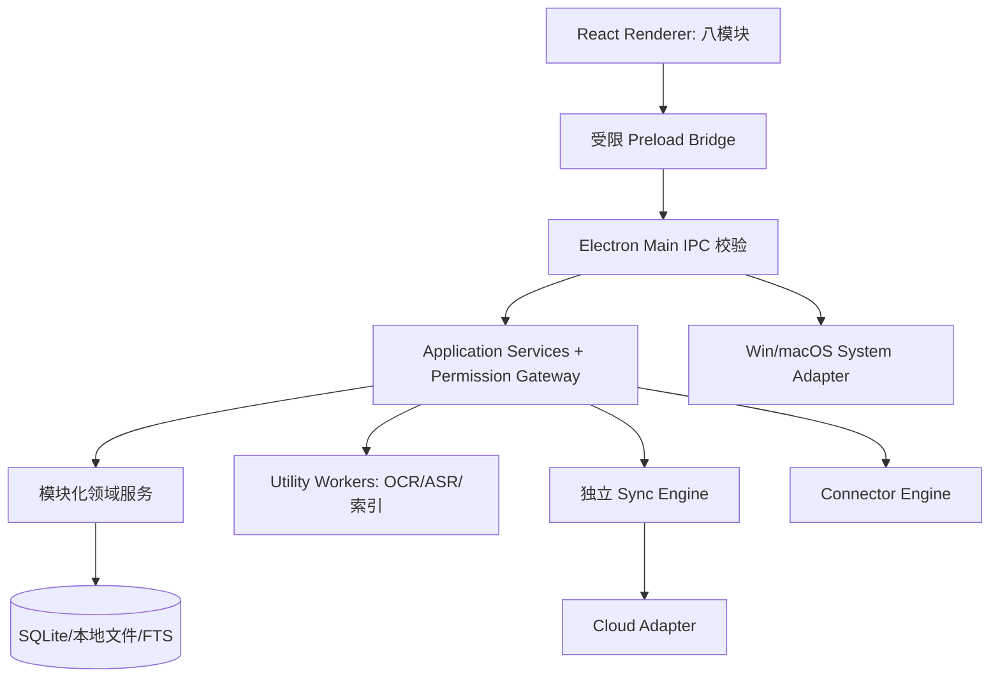

# W3-1 总体架构与运行时
## 采用架构
桌面采用 **Electron + React + TypeScript**；Rust 仅在明确需要原生性能/系统能力时按需引入，非强制依赖。Windows 首要开发，macOS 同期适配。业务代码为模块化单体，必要的团队账号与共享功能由云服务处理。

## 进程与依赖约束
- Renderer 不具有任意 Node、系统文件、令牌或 shell 权限；只能调用预定义 IPC。
- Preload 通过 contextBridge 暴露有限、验证输入/输出的 API；不能透传全部 ipcRenderer。
- Main 处理窗口、托盘、通知、IPC 发送者校验、应用生命周期。
- Worker/Utility 隔离重计算：OCR、ASR、嵌入、批量索引按需启动；限制并发、CPU/内存、超时、取消及失败恢复。
- 业务模块依赖公开 contracts；M1 唯一维护 Task；M4 关联团队审核，M8 只聚合投影，不复制权威任务。
- Cloud SDK 仅进入 Adapter，不能侵入领域层；团队权限最终由服务端核验。

## 后台状态
| 模式 | 行为 |
|---|---|
| 前台完整 | UI、计划内同步、提醒、获准的推理和索引 |
| 关闭窗口驻留（默认允许） | UI 隐藏，保留用户明确启用的必要通知/同步/专注计时 |
| 仅必要后台 | 暂停非必要 AI、批量索引、转写；长任务保存检查点 |
| 完全退出 | 停止应用拥有的后台进程、持久化待同步操作并安全解除临时专注限制 |

主窗关闭不等于进程消失；macOS 菜单栏与 Windows 托盘行为分别适配，设置可修改。开机启动可单独关闭。崩溃、睡眠/唤醒、系统注销及升级必须处理待办恢复与安全退出。

## 性能门槛
P0 记录冷启动、前台空闲/后台 RSS、CPU、唤醒频率、同步流量、索引峰值及 24h 内存增长。实际阈值需 W4 真实机器基准，不能凭空制定。外部 API、AI、本地索引失败不应破坏基础任务、日历和文件浏览。
