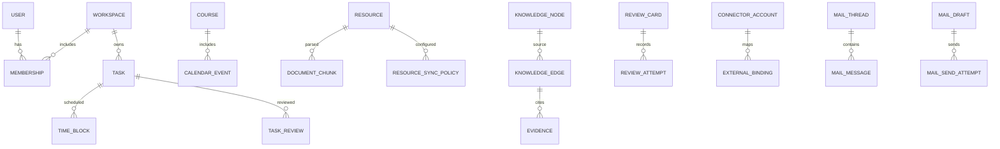

# W3 数据模型与数据库契约
> 结构设计，尚未创建 SQL 表或数据库迁移。SQLite 本地为个人操作的持久化起点，云端 PostgreSQL 为候选。时间储存 UTC，同时保留教学/会议原时区、周次与重复例外。

## ER 关联

## 实体字段草案
| 领域 | 实体及关键字段 | 归属/约束 |
|---|---|---|
| 核心 | User(id), Device(id,userId,platform), Workspace(id,kind,owner), Membership(workspaceId,userId,role,version) | 校方绑定不自动赋管理员权；本地路径不跨设备继承 |
| 任务与日历 | Task(id,workspaceId,title,dueAt,state,version), TimeBlock(taskId,start,end,sourceProposal), CalendarEvent(id,zoneId,recurrence,exceptions,locked), Course, Reminder | M1 为唯一权威任务；校方状态与个人完成分离 |
| 团队 | TeamProject, TeamMessage(deliveryState), TaskAssignment, TaskReview(policy,state), ApprovalDecision(actor,decision,at), SharedResource | 审核历史独立；P0 可选单审核，P1 可扩多人 |
| 知识 | Resource(path,hash,origin), DocumentChunk(locator,indexVersion), KnowledgeNode, KnowledgeEdge(origin,confidence,verification), Evidence(resourceId,locator), GraphRevision | 待核验 AI 边与用户确认边分离；来源可点击 |
| 复习 | ReviewCard, ReviewAttempt(id,suggestedRating,finalUserRating), ReviewSchedule(cardId,nextDue,schedulerVersion) | 用户最终掌握度调度；按唯一 Attempt 去重 |
| 专注奖励 | FocusSession(mode,exitReason), FocusRule, RewardLedger(sourceOperationId), CustomReward, Redemption | 积分幂等；异常退出不冒充任务完成 |
| AI | AIProject, AgentRun, ModelConfiguration, PlanProposal, CandidateAction(status,source,dedupeKey), PermissionGrant, ToolInvocationAudit | 候选不自动应用正式数据 |
| 接入 | ConnectorAccount(provider,scopes,credentialHandle), ExternalBinding(provider,accountId,externalId,remoteVersion), SyncCursor | 外部 ID 唯一范围包括账号 |
| 邮件 | MailThread, MailMessage(accountId,providerMessageId), MailDraft(revision,recipientSnapshot), MailSendAttempt(operationId,confirmationHash,status,remoteEvidence) | unknown 不自动重发 |
| 工作台 | DashboardLayout, WidgetConfig, ThemePreference, Notification, SearchProjection | 仅可重建投影，不复制业务权威 |
| 同步 | DomainOperation(operationId,deviceId,baseVersion), DomainEvent(eventId,schemaVersion), SyncConflict, ResourceSyncPolicy(mode), ResourceBlobVersion(hash,remoteKey) | 原件默认 localOnly，元数据/原件分开 |

## 跨表规则
同步实体采用稳定 UUID、workspaceId、createdAt、updatedAt、rowVersion、必要的 deletedAt 墓碑。索引：Task(workspaceId,dueAt,state)、CalendarEvent(time,zone)、ReviewSchedule(nextDue)、ExternalBinding(provider,accountId,externalId UNIQUE)、DomainOperation(operationId UNIQUE)。成员角色/工作空间和知识源权限为查询必要过滤条件，不能仅凭 UUID 进行访问。

从 PDF 提取的 OCR、向量、摘要和知识证据是衍生敏感数据；需记录 lineage、权限与索引失效。文件内容哈希用于版本识别，但二进制冲突不自动合并。普通个人数据本地写入与待同步 Outbox 应在同一 SQLite 事务完成。

## 迁移与恢复
Schema 版本、幂等迁移、前置检查、备份/失败恢复、旧版升级测试为 P0。SQLite WAL 不等于备份；禁止把运行中数据文件的随意复制视为唯一备份。完整字段枚举/DDL 在 W4 依据接口契约审阅后固化。
