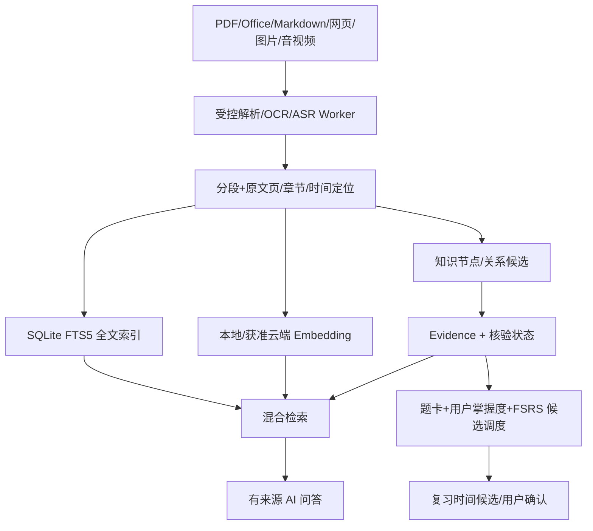

# W3 AI Runtime 与知识库体系
## 处理流水线

## Runtime 与模型
统一 AIRuntime 包含 ModelProvider、PromptManager、ContextBuilder、RetrievalService、ToolRegistry、AgentExecutor、RunLogger 和 PermissionGateway。支持用户自备 Key 或本地模型；官方托管试用额度为 P1。AI 规划只是候选，用户预览、编辑、选择性应用，不得覆盖锁定课程或未经授权修改任务。无 AI/网络时仍可使用本地任务、日历、文件浏览、全文检索、现有图谱与确定性复习调度。

## P0 知识库
导入 PDF/Word/PPT/Markdown/TXT/图片/网页/音视频，OCR 与 ASR 转写保留页码/段落/时间戳、解析版本和内容哈希。支持本地开放 Markdown/Obsidian Vault，无须安装 Obsidian/WSL。解析失败不删除原件，用户修正/外部编辑必须可重建索引。全文+向量+图谱混合检索，sqlite-vec 为候选而非已定产品依赖。向量请求传入云服务同样受外传许可。

KnowledgeNode/KnowledgeEdge/Evidence/GraphRevision 保存关系类型、来源、置信度、AI 推断/人工确认及修订历史；未核验边不能悄然成为正式复习事实。跨文档关联按权限过滤，问答必须提供真实可点击来源、缺证据时说明无法支持。

ReviewCard 含闪卡/选择/简答及可编辑参考答案；ReviewAttempt 同时保存系统建议评分与用户最终掌握度，后者决定 ReviewSchedule。评估 FSRS/ts-fsrs，离线调度不每次调用 LLM；复习日程产生候选后再按确认规则写入 M1。模拟考试及薄弱知识点专项训练仍为 P1。

## 模型和硬件可用性
Worker 按需启动、限额并发、支持取消/检查点/失败重试；本地模型和转写的 CPU 回退、包大小、内存要求需真实 Windows/macOS 低配置设备测试。用户未配置模型时清晰展示模型依赖部分不可用，而不锁死整个知识库。模型回传内容不得成为系统指令；外传范围按 Project、来源和目的地逐次核对。
