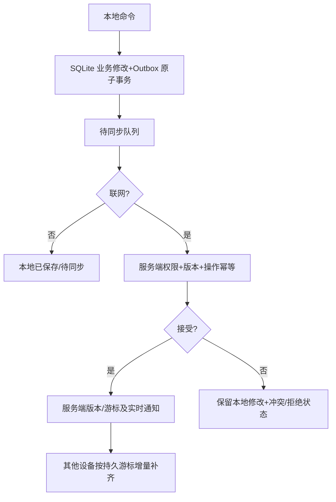

# W3 Local-first、离线同步与团队协作
## 数据权威划分
个人笔记、任务、复习等先本地 SQLite 持久化；云同步可选。团队成员、共享权限、任务审核最终由服务器核验；Canvas/教务/邮件的原始状态由对应平台控制，本地仅缓存并附加用户私人进度/备注。

## 同步协议
SyncOperation 至少有 operationId、deviceId、actorId、workspaceId、entityType、entityId、operationType、baseVersion、clientTimestamp、payload。服务端应答 accepted/duplicate/conflict/rejected/retryable_failure + serverVersion/cursor/errorCode。客户端重连、唤醒和授权变动时按持久游标拉取；实时推送可遗漏，不能作为完整数据同步的唯一依据。服务器成功但响应丢失时按 operationId 核验而非重复应用。

## 冲突策略
- Task 不同字段安全可合并；同字段或截止时间冲突保留双方版本，不能静默 LWW。
- 团队成员变更、任务认领和单人验收是服务端受控状态机；离线提交只标记 pending。
- 私人笔记保留冲突副本；KnowledgeEdge 保留用户核验历史；复习 Attempt 按 ID 去重并重新计算日程。
- PDF/音视频按内容哈希版本化，二进制并发变更不能直接合并。
- 外部平台来源更新不得覆盖用户本地私人字段；邮件发送与普通同步队列隔离，绝不因网络恢复未经确认发送。

## 逐文件与衍生内容
ResourceSyncPolicy 每个原件可选 localOnly / metadata / full；新导入大型原件默认 localOnly，批量授权可逐项覆盖。原件上传需完整性验证、失败恢复；跨系统路径重新绑定。停止同步、申请删除云副本、清本机缓存、删除本机原件是四个不同操作。元数据本身可能敏感；OCR 文本、摘要、向量、图谱需要独立的同步/访问策略。

## 实时协作与撤权
P0 必须支持真实团队聊天、资料共享、指派与认领、单负责人可选验收；P1 才考虑多人富文本共同编辑/复杂审批。团队权限撤销后服务器拒绝新访问；客户端重新联网后停止相关访问、按策略清理已缓存受保护数据，但不能承诺抹除对方离线保存的副本。

## 状态与测试
UI 区分 localOnly、pending、syncing、synced、conflict、failed、permissionDenied、unknown；被拒绝修改保存为本地草稿/冲突副本，不冒充共享已确认。双设备离线、冲突、重复请求、失效游标、大文件断线、撤权、OS 路径差异、数据库升级为 P0 测试。
